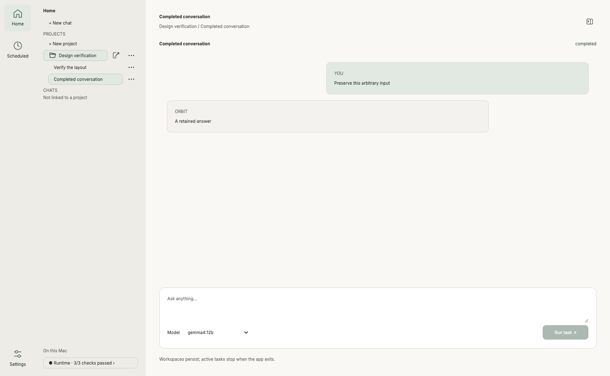

[](https://github.com/cybergarage/orbit-app/actions/workflows/ci.yml)

# Orbit App

Developer desktop workspace powered by [Orbit](https://github.com/cybergarage/orbit).

A local Electron desktop prototype for agent work. On a fresh native package,
Electron owns the Agent and sends workspace reads to network-disabled Docker
execution. File changes require a separate opt-in and per-operation approval.
The app never switches model providers as a fallback.

## Desktop preview



Current Electron UI in Light appearance, with compact Project/Chat navigation, user messages on the right, answers on the left, and Debug closed. Captured from the running app using isolated synthetic demo data; no real tasks or personal information are shown.

## About Orbit

[Orbit](https://github.com/cybergarage/orbit) is the TypeScript agent execution framework underlying this app. It provides model adapters, including Ollama, tools, sessions, and execution and approval controls. Orbit App adds the desktop interface and coordinates native host Ollama with containerized Orbit workers.

## Requirements

- macOS with Apple Silicon (verified on the secondary M4).
- Node.js 22.12 or newer and npm; CI uses Node 22, and local validation used Node 26.5.
- Running Docker Desktop and native Ollama at `http://127.0.0.1:11434`.
- An installed tool-capable Ollama model; `gemma4:12b` was verified. Models are not downloaded automatically.

## Install and run

```sh
cd ~/Src/orbit-app
# The audited local Core tarball is included; no unpublished registry version
# or machine-specific source checkout is needed for installation.
npm ci
npm run worker:reader:build
npm run package
open "release/Orbit App-darwin-arm64/Orbit App.app"
```

The native package opens the Host Agent by default for a fresh profile, with
Docker-only read and search tools. Create a project and chat, select a model,
and submit a task. Approved file changes are a separate opt-in below. Projects
use an app-managed workspace or a supported existing directory, and chats
retain their model choice and Orbit history.

Project knowledge is automatically extracted after successful conversations and
reused in related conversations in the same logical Project. No manual saving or
preview is needed. The supplementary **Project knowledge** panel provides source
inspection, correction, deletion, stopping and budgets. Closing windows keeps the
host running; explicit Quit stops it. See [use, migration, limits and validation](docs/project-knowledge.md).

## Build a local app

```sh
npm run package
open "release/Orbit App-darwin-arm64/Orbit App.app"
```

The normal unsigned macOS arm64 package builds the lock-pinned SQLite addon
for Electron using the native toolchain below. Docker and the locally built
reader image are still required; Docker images, models, signing and
notarization are not bundled. `npm run dev` and `npm run package:legacy` keep
the legacy build pathway available for source/developer checks.

### Verify Electron-host SQLite independently

On a native macOS arm64 development machine with Xcode command-line tools,
Node 26.10.0 and npm 11.19.1, run `npm run test:electron-sqlite` after
installing the normal locked App dependencies. The proof builds the existing
locked `better-sqlite3` source against the exact Electron 44.5.1 headers
(checked by SHA-256), packages a separate GUI-less test app with the native
module outside ASAR, then opens, writes, and reopens a synthetic Core Project
catalog inside its real Electron main process. It expects Electron ABI 149.

The proof downloads the pinned official headers; Electron Packager may also
fetch the exact Electron binary on a cold cache. The standalone SQLite probe
does not replace the normal Node test addon, use a real profile, start Docker,
or touch an App catalog. The native App package uses the same pinned build
path for its own Electron addon.

## Prototype features and limits

- Home/new-chat, project creation and editing with optional directory/instructions, session rename/move, conversation model selection, runtime health, operation approvals, cancellation, saved history, and top-level artifact listing.
- Scheduled definitions and a separate execution history with input, answer, operation/approval events and failure/interruption details.
- Session moves preserve original Orbit storage and working directory. Changing a project directory affects new chats only; project guidance affects future tasks. Running or recovery-pending sessions cannot move. Project/Chat names use Orbit core APIs pinned to the local `0.9.3-project-memory.0` artifact. Unsupported legacy name formats are rejected without data deletion. Supported combined profiles move their registry location without retaining a copy.
- Saved System/Light/Dark appearance and compact Project/Chat navigation, with Settings categories for Appearance and real runtime Status.
- One-time, fixed-interval and calendar schedules with a saved IANA time zone. Relative first runs start from successful creation; fixed intervals keep their planned anchor, while daily/weekly rules keep local wall time. **The app must be running.** Missed occurrences coalesce; interrupted work is not automatically replayed. There is no background daemon.
- Scheduled tasks have explicit Enable/Disable and confirmed Delete controls. Enabling retains a future slot or skips elapsed recurring slots while preserving the original interval/calendar anchor and time zone; past or already-admitted one-time slots require editing to a new future time. Editing a disabled task keeps it disabled. Disable/Delete prevent future admission and never cancel an already-admitted run. Delete removes only the definition: execution history, chats and working files remain. Changes persist across restart.
- First-input Chat titles are saved through core before Worker admission. A bounded local model call may refine the title after the task settles; manual names take priority.
- Intended for trusted local workspaces. Host-mode Docker executors receive only the selected workspace mount and no network, host credentials, or Docker socket. The legacy Agent still has workspace and Core mounts; its separately approved Bash is not a complete sandbox guarantee.
- Per-file limits and a storage watchdog are **not a hard disk quota**; rapid writes can still consume host disk space.
- Orbit's pinned `braces@3.0.3` dependency has an unpatched DoS advisory. Restricted search syntax mitigates the direct glob/grep path, but an approved Bash script can still invoke the vulnerable dependency.

See [core-backed names and storage requirements](docs/core-display-names.md) for the 0.9.2 transition and existing-data policy.

See [approved UI implementation and current validation](docs/approved-ui-implementation.md) for the latest local implementation status.

See [verification and security limitations](docs/verification.md) for tested behavior, the advisory, and residual risks.

Chats within each Project and the unassigned Chats group follow accepted user submissions, newest first. Typing, viewing, responses, names and scheduled work do not affect this order. Rejected requests do not move Chats; failures after acceptance keep their position. Order survives restart and project moves. Older Chats without explicit submission ordering retain their relative saved order until their next user submission; historical submissions have no reliable human/schedule origin and are not inferred. Project order is unchanged.

Settings → Initialization supports settings-only, saved-data, and settings/data/dedicated-cache initialization through the pinned local Orbit Core maintenance API. Each flow previews exact App-owned targets, stops and verifies writers, creates a final metadata plan, and requires explicit permanent confirmation and external exclusive-control declarations. Working files, external workspaces, shared context, unknown objects and browser profile data remain outside the allowlist. Incomplete initialization stays offline across restart; success requires restart. See [scope, ownership and failure behavior](docs/initialization-adoption.md).

Model choices come from Core's credential-aware provider catalog: choose Ollama,
Claude (Anthropic), or OpenAI together with a compatible available model in one list. Read-only Models
API verification is not an inference/billing check. Keys stay on the host; workers
use the selected real adapter through constrained RPC. Settings defaults apply to
new chats; existing choices and admitted runs remain isolated. No models are downloaded.
The bundled Core includes ModelCatalog and ModelGateway. Its exact clean source
commit and artifact hash are recorded in worker/packages/core-artifact.json;
host and worker locks and the CI source checkout use that same artifact/pin.
This artifact was reproduced with Node 26.10.0 and npm 11.19.1 on macOS
arm64; verification on other platforms uses the checked-in bytes.

### Host Agent profile selection

With no override, the native package opens an existing valid Host profile or
creates a marked `-host-agent-native-v2` sibling when the legacy root is missing
or empty. A nonempty legacy root without a Host sibling stays on the existing
legacy route. If both profiles exist, the native package resumes Host; explicitly
use `ORBIT_APP_HOST_AGENT=0` to open the independent legacy profile. A malformed
Host profile refuses startup rather than silently opening a different history.
No chat, Project memory, or files are adopted or copied.

From the checkout, the legacy escape and explicit Host selection are:

```sh
npm run worker:build   # required by the legacy route
APP="release/Orbit App-darwin-arm64/Orbit App.app/Contents/MacOS/Orbit App"
ORBIT_APP_HOST_AGENT=0 "$APP"   # open only the legacy profile
ORBIT_APP_HOST_AGENT=1 "$APP"   # open only the separate Host profile
```

Electron owns the Host Agent, model transport, session/journal state, Project
source leases, and its SQLite catalog. Missing/invalid native SQLite refuses
startup; missing Docker reader refuses task admission. Neither failure reopens
legacy. Run `npm run test:host-default` on macOS arm64 for a disposable packaged
proof of default selection, no fallback, and explicit reversion.

See [Host Agent and legacy profile adoption](docs/host-agent-adoption.md)
for the verified switch-back behavior and the prerequisites for any future
adoption action.

This slice supports chat and Docker-only `read`, `list`, `glob`, and `grep`.
The admitted workspace reader has one read-only nonrecursive workspace bind
and no network or state. Bash, project-native build/test, plugins, MCP, and
data initialization remain unavailable in this mode.
The Host Agent uses the standalone image below and does not fall back to the
legacy worker image or a host read. Interrupted runs are not replayed.
Removal of the legacy default Agent is a separate change.

File changes are separately opt-in: build `npm run worker:workspace:build`
and launch the Host Agent with `ORBIT_APP_HOST_AGENT_FILE_CHANGES=1`.
Use `ORBIT_APP_HOST_AGENT=1` as well only when you need to select Host explicitly.
Only `write` and exact-text `edit`
are added. File changes require existing parent directories. Multi-file
patches, shell, and Git are not exposed. Each file
change needs explicit approval of the Core-prepared operation. A one-shot
Docker executor mounts only the selected workspace (writable, without nested
mounts); the image contains neither Orbit nor SQLite. A missing image stops
admission; uncertain effects are not replayed or sent to another backend.

Run `npm run test:host-file-changes` on the macOS arm64 native packaging toolchain
for the packaged approval smoke. It uses a disposable profile and loopback
fixture, exercises the renderer's Deny and Approve buttons, verifies only
approved writes/edits, then reopens in read-only mode. It requires a local
Docker daemon and the two App runner tags to be unused. It refuses to replace
existing images and removes only the fixture tags that still match its own
image IDs.

Run `npm run test:host-catalog` for a disposable actual packaged App smoke:
create a synthetic Project over normal App IPC, quit and relaunch with the
same profile, verify its ID, and verify that removing the disposable bundle's
native addon fails without changing catalog bytes. The smoke points Docker
at an unavailable endpoint and does not contact model providers.

### Workspace-only execution boundary (development)

A separate Docker image handles one prepared `write` or `edit` request at a
time. The legacy route still uses its existing Docker worker for all tools
unless opted in. For local legacy development, rebuild that worker and the
runner, then opt in before launching:

```sh
npm run worker:build
npm run worker:workspace:build
ORBIT_APP_DOCKER_WORKSPACE_MUTATIONS=1 npm run dev
```

The App checks both image capabilities before starting a run and launches the
exact inspected image IDs. Old or missing images are rejected without falling
back to the worker or placing a session into recovery. Only
approved `write` and `edit` use the one-shot runner. Read, search, and shell
stay on their existing paths. Session and Project knowledge state remains in the
existing worker architecture.

The intended caller binds the selected workspace and authorizes the operation
through Core. The runner accepts a single JSON frame on stdin (up to 1 MiB),
mounts no session, Project catalog or credential directories, and returns only
a bounded text result. It opens the Linux-mounted workspace without following
symlinks, rejects hard-linked/nonregular targets and missing parent directories,
verifies the preimage again immediately before commit, and verifies the staged and
committed result digests. Creation uses a no-replace commit; overwrite is atomic.
The caller must not concurrently mutate the same workspace. As with ordinary
filesystem tools, verification and overwrite are not one atomic compare-and-swap
against independent host edits.

A refusal before commit is a known tool error. Missing/invalid reply, container
cancellation, or post-commit verification failure must be treated as unknown
settlement, never retried or rerouted to the host. The App stops the affected
worker without clearing Core's recovery guard. Inspect the actual workspace and
resolve recovery before requesting another change. No recursive directory
creation or profile migration is in scope.

The developer smoke check runs only generated files in a unique temporary
workspace and builds/removes its own uniquely tagged image:
`node --import tsx scripts/workspace-docker-smoke.ts`.


To opt into isolated reading and search independently, rebuild the regular
worker image and launch with `ORBIT_APP_DOCKER_WORKSPACE_READS=1 npm run dev`.
Only `read`, `list`, `glob`, and `grep` use this lane; both flags may be
enabled together. The one-shot reader has a nonrecursive read-only workspace
bind and no state, credentials, or Docker socket. Link traversal and special
files are refused. Each read request has its own bounded queue wait, 12-second
attach deadline, 32 KiB request cap, and 1 MiB serialized reply cap (independent
of the mutation acknowledgment cap). Traversal is capped at 12,000 directory
entries, 8 MiB per file and 32 MiB scanned per operation. If a read limit is
exceeded the tool reports a failure, not a partial success or a fallback.


### Standalone Docker reader image for the Host Agent

```sh
npm run worker:reader:build
node --import tsx scripts/workspace-reader-image-smoke.ts
```

This image packages only the existing bounded `read`, `list`, `glob`, and
`grep` implementation and its lock-pinned search libraries. Its build context
excludes the Orbit package, legacy Agent, metadata helpers, and session data.
The image has no Orbit Core or application SQLite module. Only the opt-in
Host Agent selects this image. Default and legacy tool routing are unchanged. CI verifies
execution by immutable image ID with one nonrecursive, read-only workspace
bind, no network, no state or catalog mount, and only disposable test files.

### Fixed workspace command experiment (not connected to the App)

`node --import tsx scripts/workspace-command-docker-smoke.ts` exercises a
one-shot fixture image with a single read-only, nonrecursive workspace mount,
network off, fixed subprocess arguments/environment, explicit deadline and
bounded output. It accepts named operations only: a constant Bash probe,
tracked Git index entries (without loading workspace Git config), Node syntax
validation, and one local Node test file. Test files are executable code;
use only trusted disposable fixtures in this experiment. No general shell,
networked Git, dependency installation, linked worktrees, or production
build execution is added. Git is installed when CI builds the disposable
image from the existing pinned Debian-based Node image, not at runtime.

The experiment reports a checked exit separately from refusal and unknown
termination. It does not register a tool, change user settings, call a model,
or enable a second execution path. Production Bash continues on its original
route. Before activating the command executor, Core must bind the exact
trusted execution profile to approval, preserve command-result provenance
and define cancellation and output semantics without allowing backend fallback.
