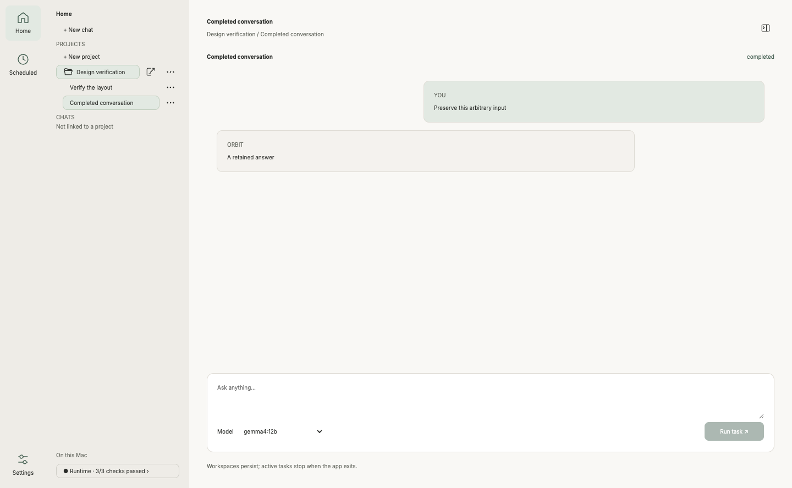

[](https://github.com/cybergarage/orbit-app/actions/workflows/ci.yml)

# Orbit App

Developer desktop workspace powered by Orbit.

Related projects: [Orbit](https://github.com/cybergarage/orbit) · [Orbit Nest](https://github.com/cybergarage/orbit-nest).

A local Electron desktop prototype for local agent work. Create a project and session, send a task to native Ollama, and review writes or commands before Orbit executes them in a network-disabled container. No cloud model fallback.

## Desktop preview



Current Electron UI in Light appearance, with compact Project/Chat navigation, user messages on the right, answers on the left, and Debug closed. Captured from the running app using isolated synthetic demo data; no real tasks or personal information are shown.

## About Orbit

[Orbit](https://github.com/cybergarage/orbit) is the TypeScript agent execution framework underlying this app. It provides model adapters, including Ollama, tools, sessions, and execution and approval controls. Orbit App adds the desktop interface and coordinates native host Ollama with containerized Orbit workers.

## Requirements

- macOS with Apple Silicon (verified on the secondary M4).
- Node.js 22.12 or newer and npm; CI uses Node 22, and local validation used Node 26.5.
- Running Docker Desktop and native Ollama at `http://127.0.0.1:11434`.
- An installed tool-capable Ollama model; `gemma4:12b` was verified. Models are not downloaded automatically.

## Install and run

```sh
cd ~/Src/orbit-app
npm ci
npm run worker:build
npm run dev
```

Create a project and session, select a model, and submit a task. Review each requested write or command, then inspect its progress, results, and workspace files. Projects use an app-managed workspace or an optional existing local directory. Conversations save their model choice and persisted Orbit history.

## Build a local app

```sh
npm run package
open "release/Orbit App-darwin-arm64/Orbit App.app"
```

The unsigned arm64 app still requires Docker, Ollama, and the locally built worker image. Docker and models are not bundled; signing and notarization are not included.

## Prototype features and limits

- Home/new-chat, project creation and editing with optional directory/instructions, session rename/move, conversation model selection, runtime health, operation approvals, cancellation, saved history, and top-level artifact listing.
- Scheduled definitions and a separate execution history with input, answer, operation/approval events and failure/interruption details.
- Session moves preserve original Orbit storage and working directory. Changing a project directory affects new chats only; project guidance affects future tasks. Running or recovery-pending sessions cannot move. Project/Chat names use Orbit core 0.9.3 APIs. Unsupported legacy name formats are rejected without data deletion. Supported combined profiles move their registry location without retaining a copy.
- Saved System/Light/Dark appearance and compact Project/Chat navigation, with Settings categories for Appearance and real runtime Status.
- One-time, fixed-interval and calendar schedules with a saved IANA time zone. Relative first runs start from successful creation; fixed intervals keep their planned anchor, while daily/weekly rules keep local wall time. **The app must be running.** Missed occurrences coalesce; interrupted work is not automatically replayed. There is no background daemon.
- Scheduled tasks have explicit Enable/Disable and confirmed Delete controls. Enabling retains a future slot or skips elapsed recurring slots while preserving the original interval/calendar anchor and time zone; past or already-admitted one-time slots require editing to a new future time. Editing a disabled task keeps it disabled. Disable/Delete prevent future admission and never cancel an already-admitted run. Delete removes only the definition: execution history, chats and working files remain. Changes persist across restart.
- First-input Chat titles are saved through core before Worker admission. A bounded local model call may refine the title after the task settles; manual names take priority.
- Intended for trusted local workspaces. Workers have no network access and receive only their project's workspace/core mounts, without host credentials or the Docker socket. This is not a complete sandbox guarantee: approved Bash can modify the project's core records.
- Per-file limits and a storage watchdog are **not a hard disk quota**; rapid writes can still consume host disk space.
- Orbit's pinned `braces@3.0.3` dependency has an unpatched DoS advisory. Restricted search syntax mitigates the direct glob/grep path, but an approved Bash script can still invoke the vulnerable dependency.

See [core-backed names and storage requirements](docs/core-display-names.md) for the 0.9.2 transition and existing-data policy.

See [approved UI implementation and current validation](docs/approved-ui-implementation.md) for the latest local implementation status.

See [verification and security limitations](docs/verification.md) for tested behavior, the advisory, and residual risks.

Chats within each Project and the unassigned Chats group follow accepted user submissions, newest first. Typing, viewing, responses, names and scheduled work do not affect this order. Rejected requests do not move Chats; failures after acceptance keep their position. Order survives restart and project moves. Older Chats without explicit submission ordering retain their relative saved order until their next user submission; historical submissions have no reliable human/schedule origin and are not inferred. Project order is unchanged.

Settings → Initialization supports settings-only, saved-data, and settings/data/dedicated-cache initialization through published Orbit core 0.9.3. Each flow previews exact App-owned targets, stops and verifies writers, creates a final metadata plan, and requires explicit permanent confirmation and external exclusive-control declarations. Working files, external workspaces, shared context, unknown objects and browser profile data remain outside the allowlist. Incomplete initialization stays offline across restart; success requires restart. See [scope, ownership and failure behavior](docs/initialization-adoption.md).
